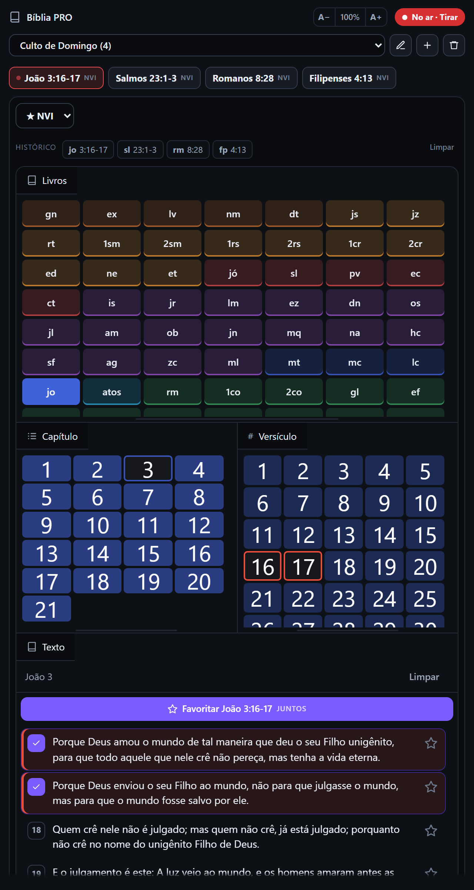

  

<h1 align="center">Bíblia PRO v1.0.0</h1>

  <b>A Bíblia do Spresenter, pronta para pregar.</b> 
  Primeira versão pública — busca, favoritos por pregação e projeção com um clique.

  
  
  

---

## ✨ Destaques desta versão

- **📖 Painel de Bíblia completo** — Livros, Capítulo, Versículo e Texto na mesma tela, no visual do painel nativo do Spresenter.
- **⌨️ Digitação direta** — com o painel em foco, digite `jo` `3` `16` e o versículo abre já marcado.
- **★ Favoritos por pregação** — listas independentes, com renomear, reordenar, excluir e **Desfazer**.
- **▶ Projeção com 1 clique** — o favorito vai ao ar; **← →** percorrem o capítulo inteiro.
- **🎨 Herança automática** — tema, fundo por tipo e camada lidos do Spresenter a cada projeção.
- **🪟 Seções redimensionáveis** — alturas e largura do Texto ajustáveis, com duplo clique para restaurar.
- **🧩 Vários versículos em um favorito** — projete o trecho **Juntos** ou **1 a 1**.
- **🕘 Histórico** — retome o que foi projetado e limpe quando quiser.

## 📸 Capturas

  

  <b>Painel completo</b> — lista da pregação, grade de livros, capítulos, versículos e o texto com os versículos marcados.

## 🚀 Instalação

1. Baixe o arquivo **`com.beone.biblia-pro-1.0.0.zip`** abaixo.
2. No Spresenter, abra **Configurações → Plugins**.
3. Instale o `.zip` e ative **Bíblia PRO**.
4. Abra o painel pelo ícone `sparkles` na barra lateral.

> Requer **Spresenter 0.3.45** ou superior.

## 📦 O que vem no pacote

| Item | Descrição |
| :-- | :-- |
| `manifest.json` | Manifesto do plugin (`com.beone.biblia-pro`) |
| `dist/code.js` | Thread de lógica: estado, favoritos e projeção |
| `dist/ui/` | Painel React completo |
| `README.md` · `LICENSE` | Documentação e licença MIT |

## ⚠️ Nota de migração

Esta versão usa um **novo identificador** (`com.beone.biblia-pro`). Ela é instalada como um plugin novo — listas, favoritos e configurações da versão anterior **não são migrados automaticamente**.

## 🧱 Stack

  
  
  
  

## 🤝 Contribuindo

Contribuições são bem-vindas. Leia [`CONTRIBUTING.md`](https://github.com/ariellaureanorosas/biblia-pro/blob/main/CONTRIBUTING.md) e abra uma issue ou pull request.

## 📄 Licença

Distribuído sob a licença **MIT**. Veja [`LICENSE`](https://github.com/ariellaureanorosas/biblia-pro/blob/main/LICENSE).

---

  Feito com dedicação para quem prepara e projeta a Palavra. 
  <a href="https://github.com/ariellaureanorosas/biblia-pro">github.com/ariellaureanorosas/biblia-pro</a>

**Full Changelog**: https://github.com/ariellaureanorosas/biblia-pro/commits/v1.0.0
