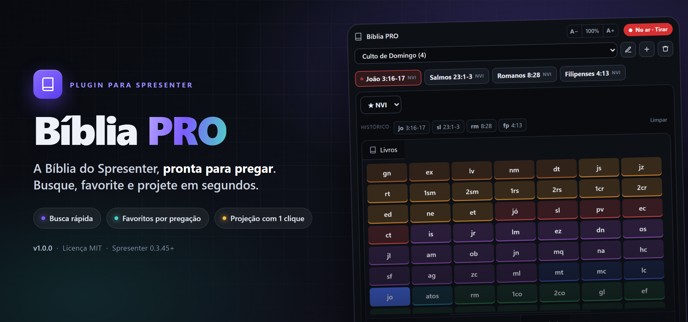
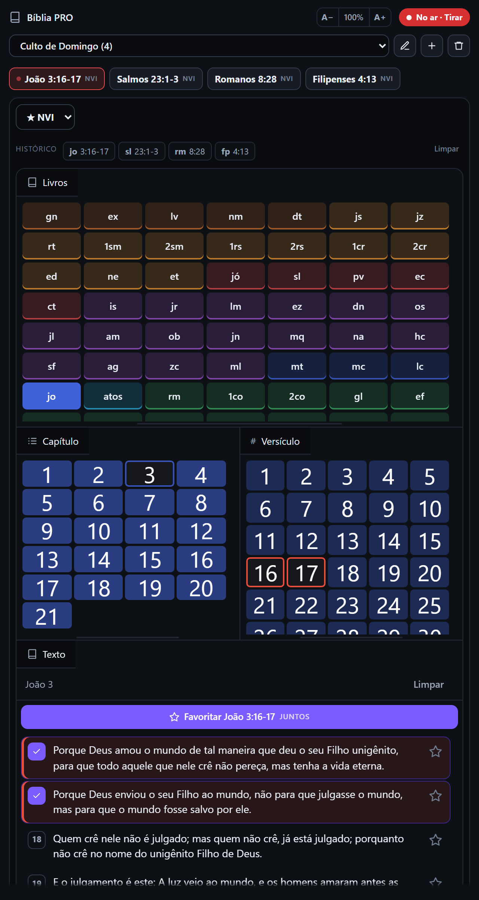

<p align="center">
  
</p>

<p align="center">
  <a href="https://github.com/ariellaureanorosas/biblia-pro/actions/workflows/ci.yml"></a>
  <a href="https://github.com/ariellaureanorosas/biblia-pro/releases"></a>
  <a href="LICENSE"></a>
  <a href="https://spresenter.com"></a>
  <a href="CONTRIBUTING.md"></a>
</p>

<p align="center">
  <b>Busque, favorite e projete versículos sem sair do Spresenter.</b><br />
  <sub>Um painel de Bíblia completo, com favoritos por pregação e projeção que herda tema, fundo e camada do app.</sub>
</p>

---

## ✨ Por que a Bíblia PRO?

| Recurso | O que faz |
| :-- | :-- |
| **⚡ Tudo em um painel** | Livros, capítulos, versículos e texto na mesma tela — no visual do painel nativo. |
| **⌨️ Digitação direta** | Com o painel em foco, digite `jo` `3` `16` e o versículo abre já marcado. |
| **★ Favoritos por pregação** | Uma lista independente para cada mensagem, com renomear, reordenar e desfazer. |
| **▶ Projeção com 1 clique** | Clique no favorito para ir ao ar. Use **← →** para percorrer o capítulo inteiro. |
| **🎨 Herança automática** | Tema, fundo e camada lidos do Spresenter a cada projeção, inclusive durante o culto. |
| **🪟 Painel que se adapta** | Seções redimensionáveis, barras de rolagem discretas e layout responsivo. |

## 📸 Capturas

<p align="center">
  
</p>

<p align="center">
  <sub><b>Painel completo</b> — lista da pregação, grade de livros, capítulos e versículos, e o texto com os versículos marcados.</sub>
</p>

<p align="center">
  
</p>

<p align="center">
  <sub><b>Digitação direta</b> — digite com o painel em foco: as sugestões aparecem por cima, sem tirar o foco da projeção.</sub>
</p>

## 🚀 Instalação

### Pelo pacote `.zip` (recomendado)

1. Baixe o pacote mais recente em [**Releases**](https://github.com/ariellaureanorosas/biblia-pro/releases) — `biblia-pro-1.0.1.zip`.
2. No Spresenter, abra **Configurações → Plugins**.
3. Instale o `.zip` e ative **Bíblia PRO**.
4. Abra o painel pelo ícone `sparkles` na barra lateral.

### A partir do código (desenvolvimento)

```bash
git clone https://github.com/ariellaureanorosas/biblia-pro.git
cd biblia-pro
npm ci
npm run build
```

No Spresenter: **Configurações → Plugins → Load folder (dev)** e selecione a pasta do repositório.

> Para iterar rápido, rode `npm run dev` em um terminal e recarregue o painel a cada alteração.

### Requisitos

| Item | Versão |
| :-- | :-- |
| Spresenter | **0.3.45** ou superior |
| SDK de plugins | 0.3.45 |
| Node.js (apenas para desenvolvimento) | 20 ou superior |

## 📖 Como usar

### 1. Crie a pregação
Cada pregação é uma lista independente. Crie com **＋**, renomeie com **✎** e exclua com **🗑** — há **Desfazer** para os últimos segundos.

### 2. Escolha o texto
- Toque no **livro**, no **capítulo** e marque os **versículos**; ou
- **Digite direto** com o painel em foco:

  ```
  jo 3 16
  ```

  As sugestões aparecem em um pop-up. **↑ ↓** navegam, **Tab** completa o nome do livro, **Enter** confirma e **Esc** cancela.
- Segure **Shift** e clique para marcar um trecho inteiro (ex.: `22 → 25`).

### 3. Favorite
O botão roxo guarda tudo o que está marcado. Vários versículos viram **um único favorito**, com o texto preservado no momento em que foi salvo — a projeção não depende de consultas externas depois.

### 4. Projete
Clique no favorito: ele vai ao ar e os quadros inferiores abrem nele.

- **Juntos** projeta o trecho inteiro em uma tela; **1 a 1** projeta um versículo por vez.
- **◀ ▶** (ou **← →**) percorrem o capítulo inteiro e seguem para o próximo.
- **Tirar do ar** (ou **Esc**) limpa a projeção.

### 5. Ajuste o painel
- Arraste as alças entre as seções para mudar alturas e a largura do Texto.
- **Duplo clique** na alça restaura o tamanho padrão.
- As alças também respondem às **setas do teclado** (Shift = passo fino).
- Os tamanhos ficam salvos nas configurações do plugin.

## ⌨️ Atalhos

| Contexto | Tecla | Ação |
| :-- | :-- | :-- |
| Painel em foco | Digitar `joa` `3` `16` | Abre o livro/capítulo e marca o versículo |
| Digitação direta | **↑ / ↓** | Navega pelas sugestões |
| Digitação direta | **Tab** | Completa o nome do livro |
| Digitação direta | **Enter** | Confirma livro, capítulo ou versículo |
| Digitação direta | **Esc** | Cancela a digitação |
| Projeção | **← / →** | Versículo anterior / próximo |
| Projeção | **Esc** | Tira do ar |
| Alças | **Setas** | Ajusta o tamanho (Shift = passo fino) |
| Alças | **Duplo clique** | Restaura o tamanho padrão |
| Renomear lista | **Enter** | Salva · **Esc** cancela |

## 🎨 Tema, fundo e camada

A cada versículo, o plugin lê a **configuração atual do Spresenter** e projeta exatamente como o painel de Bíblia faria:

- **Tema** — o tema de Bíblia configurado para cada saída (do sistema ou salvo).
- **Fundo por tipo** — o fundo de Bíblia definido em *Configurações → Camadas*, enviado uma vez para a camada de fundo.
- **Camada** — a camada padrão da Bíblia, ou a que você fixar em *Onde projetar*.

Trocou tema ou fundo nas configurações? Vale já no próximo versículo.

<details>
<summary>Como a resolução funciona por dentro</summary>

A UI lê o `config.json` publicado localmente pelo Spresenter e monta o plano de projeção em [`src/ui/appConfig.ts`](src/ui/appConfig.ts). A thread de lógica aplica o plano via `live:write`. Se a configuração não puder ser lida, o plugin usa o tema padrão de Bíblia e o catálogo local de [`src/ui/bibleThemes.ts`](src/ui/bibleThemes.ts).

Detalhes em [`docs/THEMING.md`](docs/THEMING.md).

</details>

## 🛠️ Desenvolvimento

```bash
npm ci          # instala as dependências (SDK local em sdk/)
npm run dev     # build em watch (código + UI)
npm run build   # build de produção
npm run lint    # ESLint
npm run test    # testes unitários (Vitest)
npm run typecheck
npm run package # gera release/<nome>-<versão>.zip
```

| Script | Descrição |
| :-- | :-- |
| `npm run dev` | Build em modo watch do código e da UI, em paralelo |
| `npm run build` | `dist/code.js` + `dist/ui/` |
| `npm run lint` | ESLint em todo o projeto |
| `npm run test` | Testes unitários com Vitest |
| `npm run typecheck` | Verificação de tipos com TypeScript |
| `npm run package` | Build + pacote `release/<nome>-<versão>.zip` |

### Estrutura

```
.
├─ src/
│  ├─ code.ts              # thread de lógica: estado, favoritos, projeção
│  ├─ spresenter.d.ts      # tipos do runtime do Spresenter
│  └─ ui/
│     ├─ App.tsx           # painel completo (Bíblia, favoritos, histórico)
│     ├─ main.tsx          # bootstrap React + ErrorBoundary
│     ├─ appConfig.ts      # leitura do config.json e plano de projeção
│     ├─ bibleRefs.ts      # helpers puros (referências, versões, favoritos)
│     ├─ bibleRefs.test.ts # testes unitários dos helpers
│     ├─ bibleThemes.ts    # catálogo de temas de Bíblia
│     ├─ TypeToJump.tsx    # digitação direta (livro → capítulo → versículo)
│     ├─ Resizer.tsx       # alças de redimensionamento
│     ├─ useGridColumns.ts # colunas uniformes com menos células vazias
│     └─ index.css         # tema visual do painel
├─ docs/                   # arquitetura, desenvolvimento, tema e releases
├─ scripts/package.mjs     # empacotamento do zip
├─ manifest.json           # manifesto do plugin
└─ package.json
```

> Os assets antigos são **preservados** entre builds (`emptyOutDir: false`) para que um painel aberto com `index.html` em cache não fique em branco.

Mais detalhes em [`docs/DEVELOPMENT.md`](docs/DEVELOPMENT.md).

## 🧱 Arquitetura

O Spresenter executa plugins em dois contextos isolados:

- **Thread de lógica** (`src/code.ts`) — sem DOM, mantém o estado (pregações, favoritos, histórico, configurações) e conversa com as APIs de saída/live.
- **Thread de UI** (`src/ui/`) — um app React em iframe, que envia comandos e recebe o estado por mensagens do SDK.

```
┌──────────────────────────────┐        ┌───────────────────────────────┐
│  Thread de lógica            │        │  Painel (iframe)              │
│  src/code.ts                 │◀──────▶│  src/ui/ (React)              │
│  • estado e favoritos        │  SDK   │  • busca e navegação          │
│  • histórico                 │  msgs  │  • marcação de versículos     │
│  • projeção (live/outputs)   │        │  • entrada de teclado         │
└──────────────┬───────────────┘        └───────────────┬───────────────┘
               │                                        │
               │ rotas locais /bible/*                  │
               ▼                                        ▼
        Bíblia do Spresenter                     config.json local
        (versões, livros, capítulos)             (tema, fundo, camada)
```

Contratos e decisões em [`docs/ARCHITECTURE.md`](docs/ARCHITECTURE.md).

## 🩺 Solução de problemas

| Sintoma | Causa provável | Solução |
| :-- | :-- | :-- |
| Painel em branco | Assets antigos em cache após rebuild | Feche e reabra o painel; reinicie o Spresenter |
| “Carregando…” permanente | JS da UI não executou | Confira o console e recarregue o plugin |
| “Não consegui abrir o painel” | Erro de runtime | A mensagem aparece no painel; abra uma issue com o texto |
| Tema/fundo diferentes do app | Configuração alterada após salvar o favorito | O tema é lido a cada projeção; reprojete |
| Versão da Bíblia não aparece | Bíblia não instalada no Spresenter | Instale em **Configurações → Bíblias** |

## 🤝 Contribuindo

Contribuições são bem-vindas! Leia [`CONTRIBUTING.md`](CONTRIBUTING.md) e o [`CODE_OF_CONDUCT.md`](CODE_OF_CONDUCT.md) antes de abrir uma issue ou pull request.

- Use **Conventional Commits** (`feat:`, `fix:`, `docs:`, `chore:` …).
- Rode `npm run typecheck` e `npm run build` antes de enviar.
- Descreva o comportamento observado e o esperado, com passos para reproduzir.

Encontrou uma vulnerabilidade? Veja [`SECURITY.md`](SECURITY.md).

## 🗺️ Versionamento

O projeto segue [SemVer](https://semver.org/lang/pt-BR/):

- **MAJOR** — mudanças incompatíveis (ex.: alteração do `id` do plugin).
- **MINOR** — novos recursos compatíveis.
- **PATCH** — correções compatíveis.

As notas de cada versão ficam em [`CHANGELOG.md`](CHANGELOG.md) e nas [Releases](https://github.com/ariellaureanorosas/biblia-pro/releases).

## 📄 Licença

Distribuído sob a licença **MIT**. Veja [`LICENSE`](LICENSE).

---

<p align="center">
  <sub>Feito com dedicação para quem prepara e projeta a Palavra.</sub><br />
  <sub><a href="https://github.com/ariellaureanorosas/biblia-pro">github.com/ariellaureanorosas/biblia-pro</a></sub>
</p>
